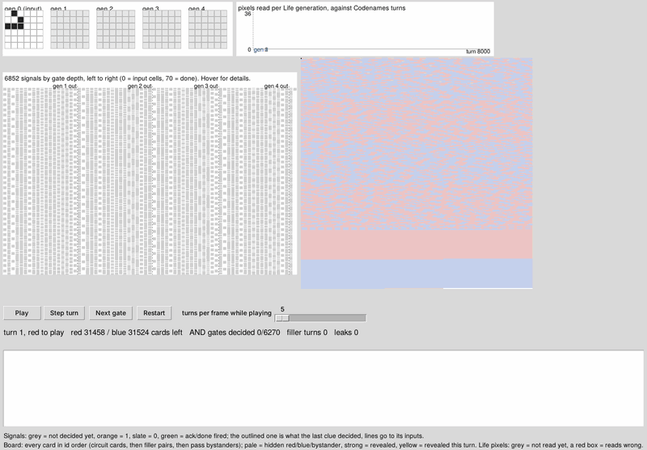

# codenames-lab

A Codenames engine in Python, word models built from NLTK, players that reason under
uncertainty, and a set of experiments on how much one clue can carry.

The engine is general: any board size, any number of teams, any kind of
token, human or computer players in any seat.

## Quick start

Python 3.12 or newer.

```bash
pip install -r requirements.txt
python -m nltk.downloader brown wordnet stopwords word2vec_sample

python -m codenames_lab.gui                  # play red against a random blue team (needs tkinter)
python -m unittest discover -s tests -t .    # tests (a few seconds, no NLTK data needed)
./run.sh e01_transfer                        # one experiment -> results/e01_transfer.jsonl
./run.sh                                     # every experiment, one after another (about two hours)
python analyze.py                            # every table -> results/tables.md

pip install yowasp-yosys                     # only for the circuit part
python -m codenames_lab.circuit.gui          # watch one game compute Game of Life
```

`QUICK=1 ./run.sh` runs each experiment at a tiny size and writes `*.quick.jsonl` files, which
is useful to check that everything runs.

## Layout

```
codenames_lab/
  game.py      board, rules, teams, the game loop, a random player
  models.py    word models: word2vec, Brown PPMI, PPMI vectors, hubness correction
  players.py   spymasters and guessers that work with any model
  words.py     board words from NLTK (common concrete nouns)
  gui.py       tkinter app
  lab.py       experiment helpers: players from config dicts, matches, JSONL output
  circuit/     Verilog compiled into one board (see "Computing inside one game")
experiments/   e01 ... e14, one question each, raw results only
analyze.py     reads results/*.jsonl, writes results/tables.md
results/       raw JSONL and the generated tables
tests/         rules invariants, exact formulas, the risk estimator, the circuit compiler
docs/          a recording of the circuit GUI
```

## Design

**The board is a grid of data.** `Board` holds cells with a token, an owner and a revealed flag.
Tokens can be words, vectors or anything else. Owners are dealt for any number of teams:
each team gets `n // (teams + 1)` cards, the first team one more, which gives the real
game's 9 / 8 / 7 / 1 on a 5x5 board.

**Rules are separate from players.** `Rules` holds the state and the legal moves and never sees
a player. `Game` holds the teams and asks the current one for a single action per `step()`.
That split is what lets a tkinter click and a computer player go through the same rules: the
GUI calls `Rules` directly for human seats, and runs computer seats on a timer.

**Players only see a `View`.** A spymaster's view shows every owner; a guesser's shows owners
only for revealed cards. The view also carries the public history, which is how players can
reason about their teammates and the other team.

**Teams decide together.** A team has one spymaster and any number of guessers. Each guesser
sees what the teammates before it proposed, and a `decide` function (majority by default)
turns the proposals into one guess.

**Players work with any word model.** A model is a clue vocabulary plus a similarity function.

| Model | What it is |
| --- | --- |
| `w2v` | NLTK's `word2vec_sample` (43,981 words, 300 dims), cosine |
| `ppmi` | positive PMI from Brown co-occurrence, window 4 |
| `ppmi-cos` | cosine between rows of the PPMI matrix |
| `w2v-hub` | `w2v` with each card's general closeness subtracted |

| Player | What it does |
| --- | --- |
| `SimSpymaster` / `SimGuesser` | biggest clue whose cards all beat the closest bad card / take the closest card |
| `SoftGuesser` | picks in softmax order at a temperature: a noisy reader |
| `RiskSpymaster` | samples how an imagined `SoftGuesser` would read every clue; gives the most expected cards under a risk limit |
| `LearningSpymaster` | a `RiskSpymaster` that learns its guesser's temperature from its picks |
| `BayesEavesdropGuesser` | uses the other team's clues and counts as evidence about their cards |
| `SecretSpymaster` | a `RiskSpymaster` that also pays for what a clue tells the other team |

**Every experiment writes raw results.** One JSONL line per unit (a game, a clue or a board),
with the full config and seed, so any game can be replayed. `analyze.py` builds every table
from those files, with standard errors and, for matches, win rates by seat.

## Experiments

Each script asks one question and writes `results/<name>.jsonl`. Sizes are the defaults.

| Script | Question | Unit, size |
| --- | --- | --- |
| `e01_transfer` | How well does a clue from model X read to a guesser on model Y? | clue, 500 boards per pair |
| `e02_model_tournament` | Which model wins when each team shares one model? | game, 200 per pair |
| `e03_belief_sweep` | What does a wrong belief about the guesser's noise cost? | clue, 100 boards per cell |
| `e04_risk_appetite` | Does a bolder risk limit win? | game, 100 per pair |
| `e05_model_gap` | Do model differences survive a noisy guesser? | game, 150 per pair and temperature |
| `e06_assassin` | Where does assassin risk come from under a noisy guesser? | board-clue-temperature-count, 60,000 rows |
| `e07_learning` | Can a spymaster learn its guesser's noise from its picks? | clue, 30 runs of 10 boards |
| `e08_eavesdrop_crude` | Does avoiding cards near the other team's clues help? (crude version) | game, 200 per row |
| `e09_vocab` | How much does a bigger clue vocabulary buy? | board, 300; plus 100 with a noisy guesser |
| `e10_secrecy` | Does a Bayesian listener help, and does paying for secrecy? | game, 200 per row |
| `e11_solvability` | Can every card be reached by a clean clue, in a real word graph? | board, 100 per size and density |
| `e12_ranked_scale` | Do ranked clues keep up as the board grows? | board, 100 per size |
| `e13_hub` | Does removing card hubness make a better similarity? | board, 300; game, 150 per row |
| `e14_life_circuit` | Does one honest game compute Life on a compiled board, and what breaks it? | game, 30 |

## Findings

All numbers are from `results/tables.md`. "±" is one standard error.

1. **A shared model is a lossless channel.** When spymaster and guesser use the same model, the
   guesser finds every card the spymaster asks for (3.8 to 6.0 on average, by model). Across models
   the first guess is right only 0.44 to 0.55 of the time, against 0.36 for a random guess (e01).
   In shared-model play the model with bigger clues tends to win: w2v beats Brown PPMI
   0.985 ± 0.009, and PPMI beats PPMI-cos only 0.025 ± 0.011 (e02). w2v and PPMI-cos give clues of
   about the same size, and that match goes mostly to whoever moves first (0.890 against 0.260).
2. **Guesser noise erases the model gap.** With a `SoftGuesser` and a spymaster that knows its
   noise, w2v's win rate against PPMI falls from 0.987 ± 0.009 at T 0.05 to 0.487 ± 0.041 at T 1.0
   (e05). At T 1.0 every model's clues average 1.2 to 1.4 cards, so the guesser is the bottleneck.
3. **Who benefits from moving first depends on skill.** The first team has 9 cards to the second
   team's 8. Pooled over e05, the first mover wins 0.596 ± 0.023 with sharp guessers (T 0.05) and
   0.424 ± 0.023 with noisy ones (T 1.0).
4. **A wrong belief about the guesser is expensive, and learnable.** At max risk 0.2, a spymaster
   that assumes T 0.2 when the truth is 1.0 asks for 5.58 cards and hits a bad card on 0.540 of
   clues (e03). A `LearningSpymaster` against a T 0.2 guesser has a belief of 0.22 by board 3 and
   finds 4.67 ± 0.10 cards on the last 3 boards, against 4.74 ± 0.10 for one told the truth (e07).
5. **Assassin risk has exact forms.** For a softmax guesser, the chance the assassin is the first
   wrong card is w_A / (w_A + Σ other non-own w), and the chance the first pick is the assassin is
   w_A / Σ w. With equal weights the first is 1/b, the uniform-guesser law. The tests check both
   with 200,000 samples. Bad cards ranked above the assassin shield it: at T 0.2 and count 3 the hit
   rate goes from 0.798 with none above it to 0.031 with two (e06).
6. **Listening and secrecy don't pay here.** A guesser that uses the other team's clues picks fewer
   of their cards but wins no more often (e10: 0.485 and 0.545, one per seat order, each ± 0.035).
   A spymaster that pays for privacy loses (κ 0.5: 0.375 ± 0.034 against 0.455 ± 0.035 for a plain
   spymaster), and the listener picks its cards no less often (0.033 against 0.030).
7. **More vocabulary buys about 1.3 cards per clue per 10x**, for a same-model guesser: w2v gains
   2.55 cards from 100 to 10,000 clue words, and the random-ranking law gains 2.73 (e09). With a
   noisy guesser the gain drops to about 0.5 per 10x.
8. **Real language keeps its clues as the board grows, if clues are read as rankings.** Under a
   global "is related" cosine threshold, the real w2v graph is never clearable at 200 cards (e11).
   A graph with the same clue degrees and random wiring is clearable 0.85 of the time at the best
   density. One that also keeps each card's degree fails too (0.01), so the failure comes from cards
   with few related clue words. Read as rankings, the best clue stays within 0.3 cards of the
   random-ranking law up to 400 cards (e12). What real language adds is a few cards that no clue
   ranks first: 5.8% of my cards on a 400-card board.
9. **There is no single best similarity.** Removing card hubness makes self-play worse (it won
   only 0.287 ± 0.037 and 0.147 ± 0.029 against plain w2v) but makes its clues read better by a
   different model (first guess right 0.540 against 0.430) (e13).

## Computing inside one game

`codenames_lab/circuit/` turns a combinational Verilog module into one large Codenames board.
Played to the end by honest players, the game computes the module, and the answer is read off
the final board. It runs on the same `Rules` as everything else.

**This board is designed, not natural.** The clue words are tokens (`w17`), and the compiler
sets every word's ranking of cards so that the rankings are the circuit. Real words come with
associations nobody can set. So this shows that honest play can carry a circuit. It does not
show that ordinary play with real words computes.

**How it works.**

- Yosys turns the Verilog into AND and NOT gates.
- Every signal has a card meaning 0 and a card meaning 1, three cards each. NOT costs
  nothing: it swaps which card means 1.
- Gate depth alternates teams: even depths are Red's, odd depths Blue's. An AND gate's
  output cards are ranked under its input cards, which belong to the other team. So a team
  can only clue an output once the other team has revealed the inputs. Turn order is the clock.
- The key card sets the inputs: the true card is the team's colour, the false one a bystander.
- Each output bit's 1-card and 0-card sit on the board. A bit reads 1 if its 1-card is
  revealed and its 0-card is not. That is the whole readout.

**The players.**

- `RankSpymaster` gives the safe word that scores the most of its own cards.
- `RankGuesser` takes the top-ranked card that is still hidden.
- Fillers and spacers make that scoring do the work. Firing a gate scores 3, a filler pair
  2, and taking the other team's card early (a "leak") 1. So the best clue is always a gate,
  or a filler while waiting, never a leak.

**What happens** (e14, `life.v`: a 6x6 torus for 4 generations, 6,270 AND gates, 63,155 cards):

- With honest players, all 21 games (the glider and 20 random states) read all 144 pixels
  correctly, with 0 leaks. A game takes 7,904 ± 23 turns, so one Life generation costs about
  2,000 turns.
- Each of three changes breaks it, with 3 games each:
  - A spymaster that gives any safe clue leaks 8,015 cards on average.
  - Gate words without spacers end in 3 turns with every pixel wrong.
  - 300 filler pairs instead of 4,000 run out, and the game leaks 436 cards on average.
- Generations overlap. Gates for generation 3 fire while generation 2 is still being read,
  because a gate fires as soon as its inputs are in.
- A game can end with a gate never decided, if no output needed it. In the glider game,
  1 of 6,270 gates.

**Watching it.** `python -m codenames_lab.circuit.gui` (or `--random 3` for a random start):



The recording is one glider game: the first 12 turns one frame each, then 200 turns per frame to
the end at turn 7,751.

- The Life frames sit on top and fill in as their pixel cards are revealed.
- Beside them, a timeline of pixels read per generation against game turns.
- Every signal is shown by gate depth, and goes orange or slate as it becomes 1 or 0.
- The whole board is shown with one square per card.
- A log says, for each turn, what the clue did. For example: `[gen 4 (1,0)] AND: n9216=0,
  because n9125=1` (from the glider game).
- Each frame is one turn. Use Step turn, Next gate, or Play with a speed.

Any other module works too:
`python -m codenames_lab.circuit.cli codenames_lab/circuit/designs/adder.v adder4 a=9 b=7`.
The tests check the 4-bit adder on all 256 inputs, and a 4x4 Life for 2 generations.

## Limits

- The guessers are models of readers, not people. `SoftGuesser`'s temperature acts on similarities
  standardised per clue, so equal T means equal noise relative to each model, not equal confusion.
- The PPMI models come from Brown, about a million words, so their associations are noisy.
- Most matches are 100 to 200 games, so a win rate carries ± 0.035 to 0.05.
- A count of 0 allows one guess here, not unlimited guesses as in the box rules.
- The circuit board's rankings are designed, as above. Red won all 30 games in e14; by design Blue can't win.
